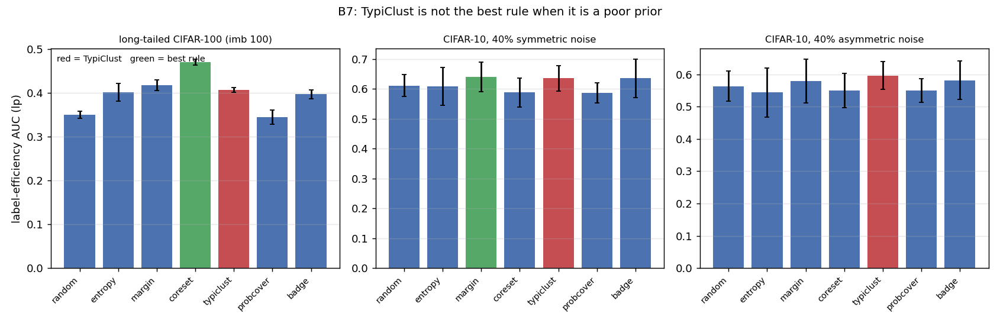
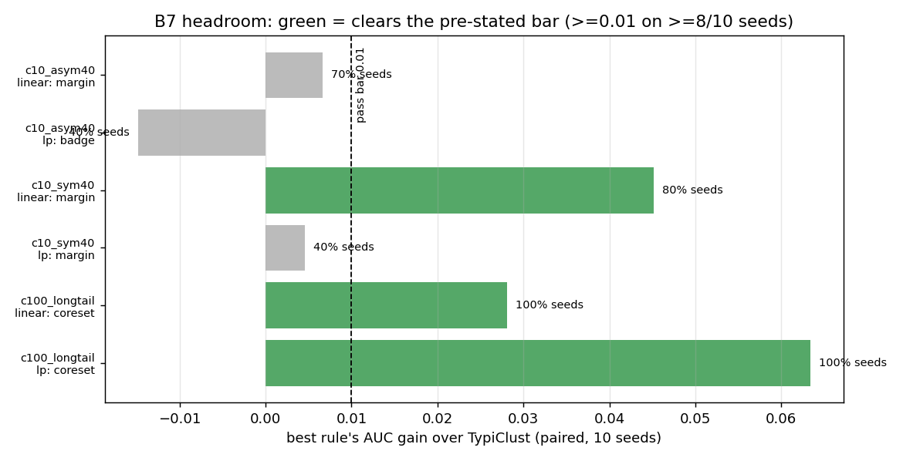

# B7 (step 1): typicality loses its edge when it is a poor prior

**2026-11-26** · verdict for B7 step 1 (precondition test for a noise/imbalance-aware learned policy).
Origin: A2 (`reports/2026-11-24-a2-al-policy`). Code: `experiments/b7_hard_al/b7_bench.py` (reuses the A2 library and
its frozen DINOv2 ViT-B/14 features). Full run: 10 seeds × 7 rules × 3 hard tasks × 2 readouts, 210 runs, on a single
small GPU.

## Question

On clean CIFAR with frozen DINOv2 features, TypiClust is the best cold-start active-learning rule in every cell and no
learned policy beats it — it leaves ~0.001 AUC of headroom (A2). A2 argued this is because "typical" points are the
right thing to label *only* when the pool is clean and balanced. B7 step 1 is the precondition test before spending
GPU time meta-training a noise/imbalance-aware policy: **on hard pools, does any existing rule already beat TypiClust?**
If none does, B7 inherits A2's negative. If some rule opens headroom, a policy that detects the regime and picks the
right geometry has something to exploit.

Three hard pools, A2 pipeline unchanged except pool construction:
- **`c100_longtail`** — CIFAR-100 subsampled to exponential class imbalance (head/tail = 100:1; order reshuffled per
  seed), balanced test set, so test accuracy is tail-sensitive.
- **`c10_sym40`** — CIFAR-10 with 40% symmetric label noise (flip to a uniform random class).
- **`c10_asym40`** — CIFAR-10 with 40% asymmetric noise (c → (c+1) mod 10, a fixed confusable map).

Budgets 10–1000 labels; linear-probe and label-propagation readouts; 10 paired seeds.

## Pre-stated criterion

**Headroom (pass):** some existing rule beats TypiClust by ≥0.01 absolute label-efficiency AUC on ≥8/10 paired seeds,
on at least one (task, readout). Then the policy build is justified.
**No headroom (fail):** TypiClust is within 0.01 of the best rule everywhere; B7 inherits A2's negative.

## Verdict: PASS — headroom exists, concentrated in long-tail and symmetric noise

Five (task, rule, readout) cells clear the bar. TypiClust is **not** the best rule once the pool is imbalanced or
symmetrically noisy; it recovers its edge only under asymmetric noise.

| Task | Readout | TypiClust AUC | Best rule | Best AUC | Gain | Seeds won |
|---|---|---|---|---|---|---|
| c100_longtail | lp | 0.406 | **Coreset** | 0.470 | **+0.063** | 10/10 |
| c100_longtail | linear | 0.375 | **Coreset** | 0.404 | **+0.028** | 10/10 |
| c10_sym40 | linear | 0.631 | **Margin** | 0.676 | **+0.045** | 8/10 |
| c10_sym40 | linear | 0.631 | BADGE | 0.665 | +0.034 | 8/10 |
| c100_longtail | lp | 0.406 | Margin | 0.417 | +0.011 | 9/10 |
| c10_asym40 | linear | 0.572 | Margin | 0.579 | +0.007 | 7/10 (below bar) |
| c10_sym40 | lp | 0.635 | BADGE | 0.635 | +0.000 | 4/10 (no headroom) |
| c10_asym40 | lp | 0.597 | — | — | ≤0 | none (no headroom) |

Read-through of the mechanism:
- **Long-tailed pool → coverage beats density.** TypiClust samples the dense modes, which over-represent head classes
  and starve the tail; the test set is balanced, so this costs tail accuracy. Coreset's max-min coverage objective
  reaches the tail and wins by a wide, fully consistent margin (+0.063 lp, 10/10) — the largest headroom anywhere.
- **Symmetric noise → uncertainty beats density.** With 40% uniform flips, Margin and BADGE (uncertainty / gradient-
  magnitude) beat TypiClust by 0.03–0.045 on the linear readout (8/10). Under the smoothing label-propagation readout
  the gap closes (noisy neighbours are averaged out), so the headroom is readout-dependent.
- **Asymmetric noise → nothing clean wins.** The c→c+1 structure makes the noise look like a confusable class rather
  than scatter; no rule reliably beats TypiClust (Margin +0.007 at 7/10, below the bar). This is the hard regime and
  the honest limit of the result: a policy has no obvious fixed rule to imitate here.

## Prior work (literature check, logged with the verdict)

Active learning under class imbalance and under label noise are each well studied; the pair together is the active
frontier, and a learned B7 policy would have to clear more than the seven generic rules used here:
- **DIRECT** (Nuggehalli, Zhang, Jain, Nowak; "Deep Active Learning under Imbalance and Label Noise", arXiv 2312.09196,
  improved v4 Jun 2025) treats imbalance **and** noise jointly by reducing to 1-D agnostic active learning, claiming
  >60% annotation savings vs SOTA AL and robustness to noise. It is the strongest hand-designed baseline in this exact
  setting.
- **Foundation-model-prior AL** (Zhang et al., "Active Learning with Foundation Model Priors: Efficient Learning under
  Class Imbalance", ICML 2026) works on frozen foundation features — the same regime as our DINOv2 pipeline — and
  reports >50% savings under imbalance.
- GALAXY (graph-based) is noted by DIRECT to degrade under high label noise and to lack batch labeling.

Implication: B7 step 1 confirms the *premise* (TypiClust is beatable on hard pools), but a learned policy is only
paper-worthy if it beats DIRECT / the foundation-prior method, not merely TypiClust and the generic rules. The policy
build is justified; its bar is now these specialized baselines.

## Decision

- B7 → **policy build justified** (pass), scoped to the two regimes with real headroom (long-tail, symmetric noise).
  Asymmetric noise is recorded as the regime where no fixed rule — and so plausibly no imitation policy — has an edge.
- The policy must be benchmarked against DIRECT and the foundation-model-prior method, at matched budget and features,
  with the per-regime best fixed rule (Coreset / Margin) as the imitation ceiling and TypiClust as the clean-data
  anchor. 3+ seeds, pre-stated AUC-headroom criterion.

## Figures

### 1. AUC per rule by task
TypiClust (red) trails the best rule (green) on long-tail and symmetric noise; it is competitive only under asymmetric
noise.

### 2. Headroom over TypiClust
Best rule's paired AUC gain over TypiClust per (task, readout); green bars clear the pre-stated bar.

