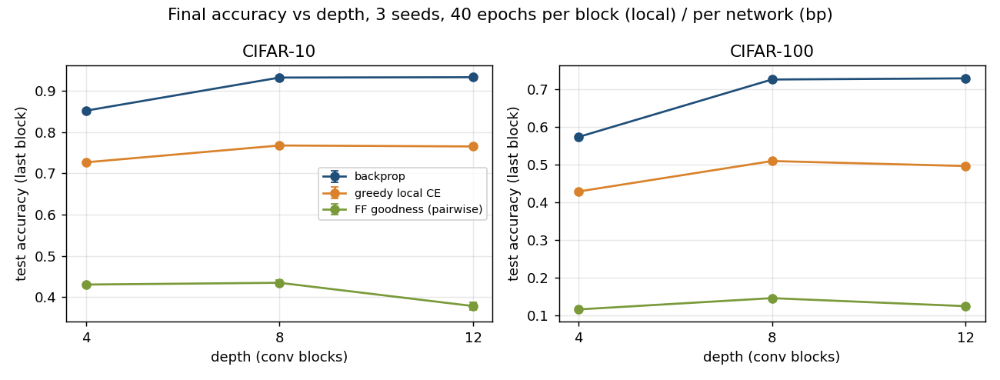
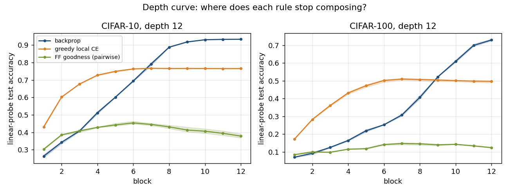

# B1: layer-local learning composes with depth on CIFAR, then plateaus — and trails backprop by 12-23 pp

**2026-11-27** · verdict for B1. Origin: Random-Ideas PR #46 (`2026-11-11-forward-forward-negatives`) and PR #60
(`2026-11-25-ff-selfsup-pairwise`). Code: `experiments/b1_ff_depth/b1_depth.py`. Results:
`results/b1_ff_depth/1303586/summary.json`. Full run: 3 rules × depth {4, 8, 12} × CIFAR-10/100 × 3 seeds = 54 cells
on a single 48 GB GPU (~3 h wall clock, 3 cells at a time). Figures: `make_figures.py`.

## Question

On MNIST with a 3×500 MLP, the daily runs split Forward-Forward's gap to backprop into **locality** (free: greedy
layer-local cross-entropy beat the backprop MLP) and **the goodness objective** (the cost). Their sharpest negative was
that **depth added nothing** to a local learner — the layers acted like independent one-layer classifiers. MNIST can't
test whether locality composes, because one layer is nearly enough there. On CIFAR it is not.

Same conv stack for every rule (3×3 conv → BN → ReLU blocks, widths 64→512, stride-2 where width grows, GAP + linear
head), crop+flip augmentation, SGD + cosine, 40 epochs:
- **`bp`**: end-to-end backprop (40 epochs for the whole network). Detached per-block linear probes give its depth
  curve.
- **`local_ce`**: greedy layer-local cross-entropy. Each block gets **40 epochs of its own** on the frozen,
  detached output of the blocks below, with its own linear-on-GAP CE head. This is locality with a standard loss.
- **`ff`**: greedy layer-local goodness with the pairwise SymBa loss (supervised Forward-Forward, label written into
  extra input channels, no BN, RMS norm between blocks). The readout is a neutral-overlay linear probe per block. This
  is locality plus the goodness loss.

Local rules therefore get *more* optimisation steps than backprop (depth × 40 epochs), so a gap is not a step
shortage.

## Pre-stated criteria

- **H1 parity (pass):** on CIFAR-10, the best local rule is within **3 pp** of `bp` at equal depth on ≥2/3 seeds.
- **H2 composition (pass):** for the best local rule, the deepest block's probe beats the first block's by **≥5 pp** on
  CIFAR-10 on ≥2/3 seeds. **Fail:** the local depth curve is flat while `bp`'s is not.

## Verdict

- **H1: FAIL.** The gap to backprop is large, and it widens with depth until both plateau.
- **H2: PASS as stated (+33 pp, 3/3 seeds).** Local CE composes, unlike on MNIST. The caveat the bar didn't anticipate
  is that it **stops composing at about block 7**, while backprop keeps gaining to block 10-12.

Test accuracy at the last block, mean of 3 seeds (seed std ≤ 0.007 everywhere):

| dataset | depth | bp | local CE | FF goodness | gap bp − local CE |
|---|---|---|---|---|---|
| CIFAR-10 | 4 | 0.852 | 0.727 | 0.431 | 12.5 pp |
| CIFAR-10 | 8 | 0.932 | 0.767 | 0.435 | 16.4 pp |
| CIFAR-10 | 12 | 0.933 | 0.765 | 0.379 | 16.7 pp |
| CIFAR-100 | 4 | 0.574 | 0.429 | 0.115 | 14.5 pp |
| CIFAR-100 | 8 | 0.727 | 0.510 | 0.145 | 21.7 pp |
| CIFAR-100 | 12 | 0.730 | 0.497 | 0.124 | 23.3 pp |

### Where each rule stops composing (depth-12 networks)

| | CIFAR-10 block 1 | block 6 | peak (block) | block 12 |
|---|---|---|---|---|
| bp | 0.26 | 0.69 | 0.933 (12) | 0.933 |
| local CE | 0.43 | 0.76 | 0.768 (7) | 0.765 |
| FF goodness | 0.30 | 0.45 | 0.454 (6) | 0.379 |

What the curves show:
1. **Greedy blocks are discriminative early.** Local CE's block-1 probe is 0.43 against backprop's 0.26: each greedy
   block is pushed to be a good classifier by itself.
2. **They stop gaining after ~7 blocks.** Blocks 7-12 add +0.0 pp on CIFAR-10 and slightly hurt on CIFAR-100
   (0.510 → 0.497). Backprop's early blocks are worse probes but keep information that later blocks use; its curve
   crosses local CE at block 7 (CIFAR-10) and block 9 (CIFAR-100).
3. **The goodness objective is far worse at conv depth than on MNIST.** It peaks at block 6 and then *degrades*
   (0.45 → 0.38 on CIFAR-10). It is 42-61 pp below backprop and 30-39 pp below local CE, so on CIFAR both locality
   and the goodness loss are costs, and the goodness loss is the larger one.

So the MNIST conclusion ("locality is free, the loss is the cost") does **not** carry over to a hard task. The
threshold → pairwise loss fix that closed FF's gap on MNIST leaves it about 50 pp behind backprop on CIFAR-10. Even with a
standard CE loss, greedy locality costs 12-23 pp and caps useful depth at about 7 blocks.

## Relation to prior work

Greedy layerwise CE on CIFAR trailing backprop by a few points with *strong* auxiliary heads is known (Belilovsky et
al., ICML 2019; Nøkland & Eidnes, 2019). The plateau matches the **information collapse** described by InfoPro (Wang et
al., ICLR 2021, arXiv 2101.10832): a module trained only on its own CE throws away input information that later
modules need. InfoPro fixes this with a reconstruction term. Our linear-on-GAP local head is deliberately the
weakest readout, which is the FF-style setting (one linear readout per layer). That is why the gap here is larger
than in those papers. What this report adds is a controlled three-way decomposition (bp / local CE / FF goodness) at
equal architecture with a full per-block depth curve, showing where each rule stops composing.

## Follow-up (running): B1b

Is the 16 pp locality cost locality itself, or the weak local objective? `local_aux` (Belilovsky-style conv + 2×2-pool
auxiliary head) and `local_rec` (InfoPro-style reconstruction term) at depth {8, 12}, same seeds and epochs, with a
pre-stated parity bar (within 3 pp of bp at d8 on CIFAR-10) and plateau bar (block 12 beats block 6 by ≥2 pp).
See `experiments/b1_ff_depth/README.md`.

## Caveats

- One architecture family (plain conv, no residuals) and one optimiser recipe tuned for backprop (SGD 0.1, cosine).
  Local rules may prefer other learning rates. The FF arm especially got no tuning beyond the MNIST recipe.
- `ff` readout uses a neutral label overlay with linear probes. Hinton's goodness-over-all-labels readout was not
  tried, though on MNIST the two readouts were close.
- Each local block trains for 40 epochs on a frozen base, so local rules used up to 12× backprop's per-block
  optimisation. A shorter local schedule could only make them look worse.
